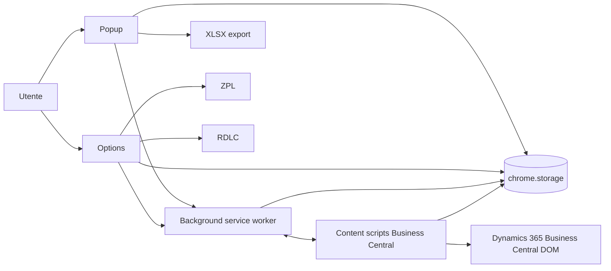
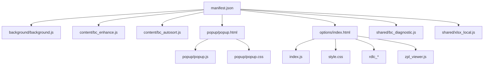

# BC_tools — Architecture (Manifest V3)

## Scopo e confini
Estensione Chrome MV3 per Dynamics 365 Business Central. Fornisce:
- **Popup**: azioni rapide e apertura pagine/ricerche; esportazioni (XLSX).
- **Options**: configurazione UI/behavior e contenuti (inclusi tour guidato, ZPL e RDLC).
- **Content scripts** su Business Central: forzatura opzionale Wide/FactBox su tutte le pagine, autosort ed enhance UI.
- **Background service worker**: gestione settings e ricostruzione menu contestuale/azioni.

Non introduce dipendenze remote, bundler o runtime alternativo.

## Entry point (da manifest.json)
- **Background**: `src/background/background.js` (service worker)
- **Popup**: `src/popup/popup.html` (action.default_popup)
- **Options**: `src/options/index.html` (options_ui.page)
- **Content scripts** (run_at=document_start, all_frames=true):
  - `src/content/bc_enhance.js`
  - `src/content/bc_autosort.js`
  - CSS: `src/content/bc_enhance.css`

## Albero runtime (solo file effettivamente referenziati)
- `manifest.json`
- `src/background/background.js`
- `src/content/bc_enhance.js`
- `src/content/bc_autosort.js`
- `src/content/bc_enhance.css`
- `src/popup/popup.html`
- `src/popup/popup.js`
- `src/popup/popup.css`
- `src/options/index.html`
- `src/options/index.js`
- `src/options/style.css`
- `src/options/index_add_excluded_pages.js`
- `src/options/index_included_pages.js`
- `src/options/index_layout.js`
- `src/options/rdlc_core.js`
- `src/options/rdlc_mapper.js`
- `src/options/rdlc_preview.js`
- `src/options/zpl_viewer.js`
- `src/shared/xlsx_local.js`
- `src/shared/bc_diagnostic.js`

> Nota: l’elenco delle entry e load di script CSS/JS è basato sui file esistenti e sui riferimenti presenti nelle HTML. Per content script MV3, la diagnostica è resa disponibile via chiamate a `window.bcToolsDiagnostic` (che nel content script dipende dalla presenza di `src/shared/bc_diagnostic.js` come script incluso/garantito dal contesto di pagina; in base al vincolo MV3 senza caricamento dinamico).

## Responsabilità
### Background (`src/background/background.js`)
- Salvataggio e sincronizzazione impostazioni (chrome.storage)
- Ricostruzione/aggiornamento menu contestuale e gestione azioni
- Relay comandi (es. toggle-wide) verso content script
- Diagnostica: persistenza e limite record

### Content (`src/content/bc_enhance.js`, `src/content/bc_autosort.js`)
- UI/forzature per wide/FactBox persistence (layout)
- Autosort e regole per pagine incluse/escluse
- UI event listeners e diagnostica non bloccante

### Popup (`src/popup/popup.js`)
- Rendering tiles/azioni
- Lettura impostazioni e invio messaggi verso background/content
- Diagnostica tramite `src/shared/bc_diagnostic.js`

### Options (`src/options/index.js` e moduli correlati)
- UI configurazione, persistenza e validazione
- Flussi RDLC e ZPL (viewer/mapper/preview)
- Diagnostica tramite `src/shared/bc_diagnostic.js`

### Shared (`src/shared/bc_diagnostic.js`, `src/shared/xlsx_local.js`)
- `bc_diagnostic.js`: utility per inviare eventi diagnostici con payload stabile
- `bc_url_context.js`: validazione del tab Business Central sorgente e costruzione URL
- `xlsx_local.js`: supporto locale per export XLSX

## Storage: chiavi e proprietario logico
Questa sezione è una mappa logica (chiavi esatte derivano dalle costanti nel codice):
- `autoWide` e `forceFactbox` controllano separatamente la forzatura Wide e la chiusura FactBox; `popupLayout`, `optionsLayout`, `includedPages`, `includedPageNames`, `quickFilters`, `quickTables`, `autoSortFirstColumn`, `sortDirection`, ecc.
- `bcToolsUiSettings`: backup raggruppato per settings UI.
- `bcToolsDiagnostics`: buffer diagnostico (background).

Proprietari:
- **Options/Popup/Content**: leggono/scrivono settings via `chrome.storage.sync` e/o `chrome.storage.local`.
- **Background**: applica/normalizza e salva, e persiste diagnostica con limite.

## Messaggi runtime (mittente/destinatario/payload)
- `type: BC_TOOLS_DIAGNOSTIC_APPEND` (mittenti: popup/content/options via `bc_diagnostic.js`; destinatario: background che salva/limita)
- Altri messaggi di feature (popup/options -> background, background -> content) sono presenti in `src/popup/popup.js`, `src/options/index.js` e `src/background/background.js`.

## Flussi principali
1. Utente apre popup → carica impostazioni → invia comandi ad action verso background/content.
2. Utente apre options → aggiorna settings → persistenza su chrome.storage → background aggiorna menu/behavior.
3. Content script su Business Central → applica UI enhancements e persiste layout/factbox → eventuale invio diagnostica.
4. RDLC/ZPL: options gestisce import/preview e visualizzatori; background non è necessario per rendering locale.

## Diagrammi
### 1) High-level flow


### 2) Albero moduli finali (runtime)


### 3) Sequence messaggi diagnostica
```mermaid
sequenceDiagram
  participant Pop as Popup/Options/Content
  participant Diag as bc_diagnostic.js
  participant BG as Background service worker
  participant ST as chrome.storage

  Pop->>Diag: sendDiagnostic({type,event,details})
  Diag->>BG: runtime.sendMessage(BC_TOOLS_DIAGNOSTIC_APPEND)
  BG->>ST: storage.local/sync append (limit)
  BG-->>Diag: (callback; non bloccante)
```

## Rischi noti e punti di estensione sicuri
- Diagnostica: richiede che `window.bcToolsDiagnostic` sia disponibile nel contesto che invia eventi.
- Content script: evitare modifiche a ordine/necessità di script e listener.
- Qualsiasi separazione deve preservare payload e nomi messaggi/storage.

## Separazione tra runtime, test, documentazione, tooling AI
- `src/` contiene runtime.
- `tests/` contiene suite Node per logica isolata.
- `docs/` contiene documentazione.
- `.agents/`, `.codebase-memory/` e `.mcp.json` sono tooling e non devono entrare nel pacchetto runtime.
